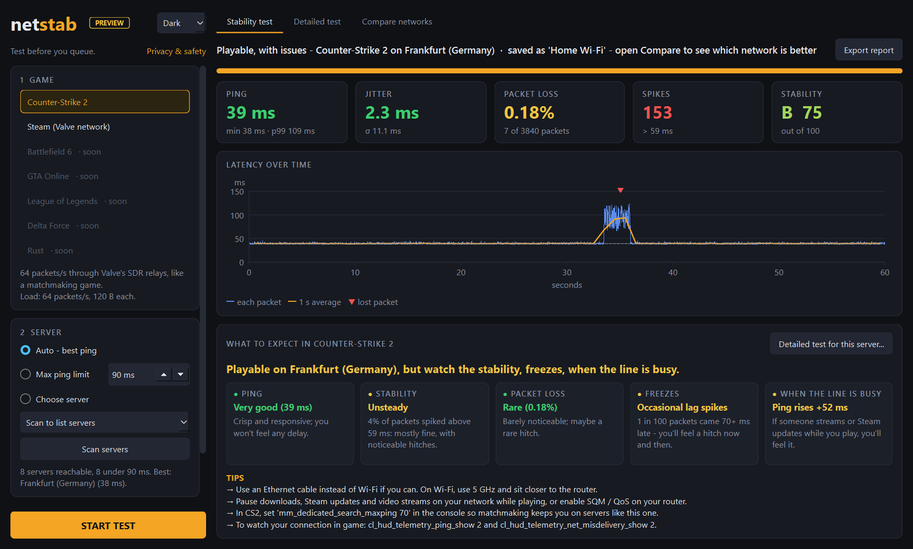
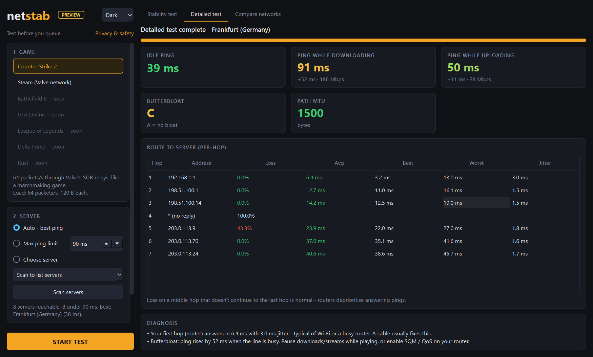
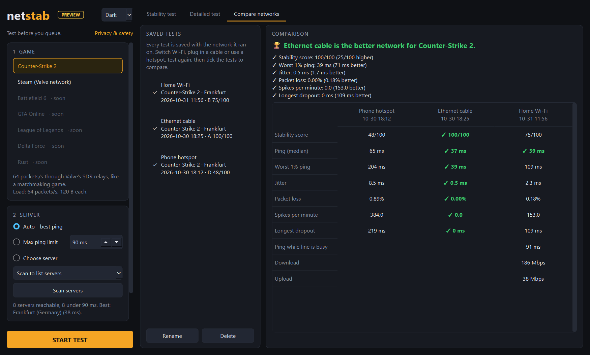
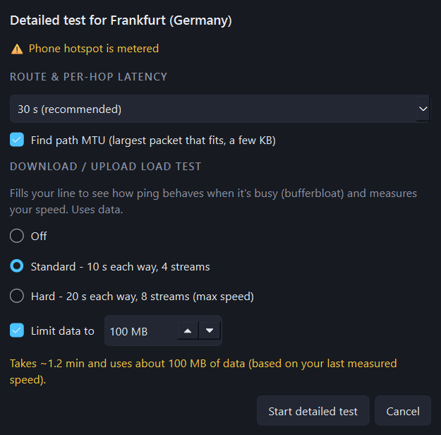
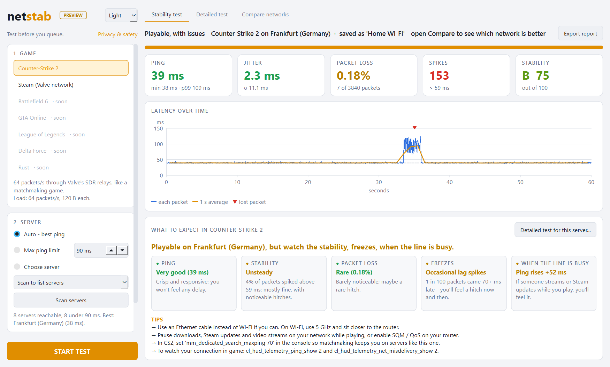
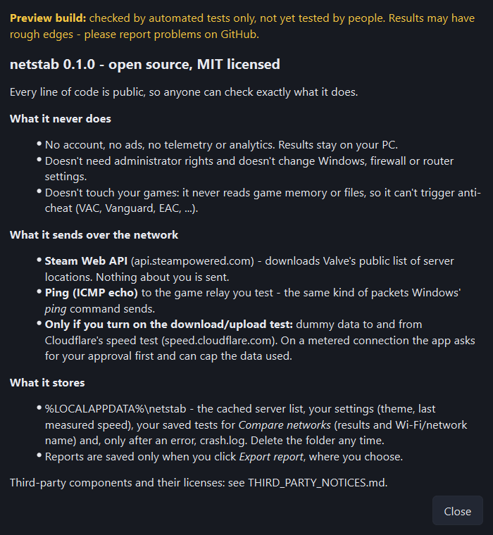

# netstab

> [!NOTE]
> **Version 0.1.0** has been tested by its author on Windows 11, on top of
> automated tests: unit tests, end-to-end tests that drive the real app on a
> real connection, and a self-test of the built `.exe`. It hasn't been tried on
> Windows 10 or on many other PCs yet, so please report problems in
> [Issues](../../issues). The 0.1.0 app still shows a **PREVIEW** badge; it goes
> away in the next version.

**Test your connection before you queue.** netstab checks whether your network
is ready for an online game, not with a one-off speed test but by sending a
game-like packet stream to the game's real servers for 30 seconds to 5 minutes
and measuring how stable it is.

Counter-Strike 2 is fully supported. Steam (Valve network) works too.
Battlefield 6, GTA Online, League of Legends, Delta Force and Rust are planned.



<details>
<summary><b>More screenshots</b>: detailed test, network comparison, metered approval, light theme, privacy</summary>

**Detailed test:** route with per-hop latency, path MTU, and how much ping rises while the line is busy.


**Compare networks:** each test is saved with its network; the winner on each line is marked.


**On a metered connection** the download/upload test is off by default, shows the data it will use, and can be capped.


**Light theme**


**Privacy & safety**, shown in the app


</details>

*Screenshots use sample data (`python tools\make_screenshots.py`): network
names are made up and IP addresses are from the ranges reserved for
documentation, so they show no one's real details.*

## Download and run

netstab is a **portable app**: one `netstab.exe` (about 31 MB) for 64-bit
Windows 10 and 11. Download it and double-click it. There's nothing to install
and nothing else is needed: Python, Qt and every library are inside the file,
and it doesn't call PowerShell or any other program.

- **First launch:** the .exe isn't code-signed yet, so Windows SmartScreen may
  say "Windows protected your PC". Click **More info → Run anyway**.
- **Smart App Control:** on Windows 11 PCs where Smart App Control is turned on,
  Windows may block an unsigned app it doesn't know yet, and there's no
  "Run anyway" button. Code signing will fix this. Until then, check the file's
  SHA-256 against the one on the release page, and run from source if it's
  blocked (see below). Don't turn Smart App Control off for this; it can't be
  turned back on without reinstalling Windows.
- **Startup:** a splash screen appears within about a second, and the main
  window after about 8–13 seconds, depending on how busy the PC is. A one-file app unpacks itself to a temporary folder on
  each launch, and Windows Defender scans those files every time.
- Only one copy runs at a time; opening it again brings the running window to
  the front, so two tests can't disturb each other.
- To remove it, delete `netstab.exe` and the `%LOCALAPPDATA%\netstab` folder.

## What it does

1. **Pick a game.** For CS2 the load is 64 packets per second (about the
   game's own tick traffic) to Valve's SDR relays, the same relays matchmaking uses.
2. **Pick a server.** Choose *Auto* (lowest ping), *Max ping limit* (the same
   idea as CS2's `mm_dedicated_search_maxping`, 90 ms by default) or a
   specific server. The server list comes live from Steam.
3. **Pick a duration:** 30 s, 1, 2 or 5 minutes.

You get:

- **Live chart** of every packet's ping, a 1-second average and lost packets.
- **Ping, jitter, packet loss, spikes and a stability grade** (A-F, 0-100).
- **What to expect in game.** Plain-language comments such as *"Slight
  delay. Enemies peeking you get a small head start"*, plus tips like the
  `mm_dedicated_search_maxping` value to use, whether to use a cable, and the
  CS2 packet-loss buffering setting.
- **Detailed test** (optional, offered after each run). Choose any of:
  - **Route and per-hop latency** (MTR style), which shows whether a problem
    starts at your router/Wi-Fi, your ISP or further away.
  - **Path MTU.**
  - **Download/upload load test** (*Standard* or *Hard*): how much your ping
    rises when the line is busy (bufferbloat), plus your speed.
- **Compare networks.** Every test is saved under the network it ran on (your
  Wi-Fi name, for example). Switch to a cable, another Wi-Fi or a phone
  hotspot, test again, and the *Compare networks* tab shows them side by side,
  marks the winner on each metric and tells you which network is better.
- **Export report** (JSON) to share or to send to your ISP.
- Dark, light or follow-Windows **theme**.

## Privacy and safety

netstab is open source (MIT), so anyone can read exactly what it does.

- **No account, no ads, no telemetry.** Results stay on your PC.
- **No administrator rights needed.** It never changes Windows, firewall or
  router settings.
- **Never touches your games.** It doesn't read game memory or files, so it
  can't trigger anti-cheat (VAC, Vanguard, EAC and so on).
- **What goes over the network:**
  - `api.steampowered.com`: Valve's public server list. Nothing about you is sent.
  - ICMP echo (ping) to the game relay you test.
  - `speed.cloudflare.com`: only if you turn on the download/upload test.
    It sends and receives dummy data.
- **Metered connections:** netstab reads Windows' *metered connection* flag.
  On a metered or roaming connection the load test is off by default. If you
  turn it on, it shows how much data the test will use, lets you cap it, and
  asks for your approval before using any data.
- **Local files:** `%LOCALAPPDATA%\netstab` holds the cached server list,
  settings, test history and, if the app ever hits an error, `crash.log`.
  Delete it any time.

Third-party licenses are listed in [THIRD_PARTY_NOTICES.md](THIRD_PARTY_NOTICES.md).

## Run from source

Requires Windows 10/11 and Python 3.11+.

```powershell
python -m pip install -r requirements.txt
python -m netstab
```

Command line (no UI):

```powershell
python -m netstab.cli --game cs2 --duration 60 --max-ping 90 --detailed
```

## Build the portable .exe

```powershell
python -m pip install -r requirements-dev.txt
python tools\build_exe.py
```

This produces `dist\netstab.exe`. The packing rules are in
`tools\netstab.spec`, which leaves out the Qt parts the app never uses to
keep the file small and startup fast. After building, the script runs the
exe's self-test from an empty folder with only Windows on `PATH` and prints
PASS/FAIL for each check. Don't ship a build that fails it.
`build.ps1` does the same and runs the unit tests first.

Releases are built and self-tested this way on the maintainer's PC, and the
release page lists each file's SHA-256.

**Optional code signing** (not used for releases):
`python tools\build_exe.py --sign-thumbprint <SHA1>` signs with a certificate
from the Windows certificate store before the self-test (`tools\sign_exe.py`,
needs the Windows SDK).

## Tests

```powershell
python -m pytest              # unit tests, offline
python tests\e2e_gui.py       # drives the real UI against the real network
python tests\e2e_gui.py --no-data   # same, without the download/upload test
dist\netstab.exe --selftest C:\some\folder   # checks a built exe; writes selftest.json
python tools\startup_time.py 3               # seconds to splash and to main window
```

## How it measures

- Pings use the Windows ICMP API (`IcmpSendEcho`), which works without admin
  rights. Each round trip is timed with a high-resolution clock, not Windows'
  1 ms counter.
- Packets go out on a fixed clock like game ticks, so a slow reply never delays
  the next packet.
- **Jitter** is the mean change between consecutive replies (RFC 3550 style).
  A **spike** is a reply more than max(20 ms, 6×MAD) above the median.
  **Longest dropout** is the longest run of consecutive lost packets.

## Project layout

```
netstab/
  icmp.py      Windows ICMP API wrapper
  profiles.py  per-game traffic profiles
  servers.py   server discovery (Valve SDR) and selection
  engine.py    the timed load test
  stats.py     statistics and grading
  advice.py    "what to expect in game" comments and tips
  detailed.py  route/per-hop, MTU, bufferbloat and speed
  metered.py   Windows metered-connection check
  compare.py   test history and network comparison
  gui.py       PySide6 desktop UI
  cli.py       command-line runner
  selftest.py  checks every feature from inside a built exe
  assets/      app icon
tools/
  build_exe.py   builds and self-tests dist\netstab.exe
  netstab.spec   PyInstaller packing rules
  make_icon.py   draws the icon and the splash
  make_screenshots.py  README screenshots from sample data
  startup_time.py      measures time to splash and to window
docs/screenshots/      the images above
```
